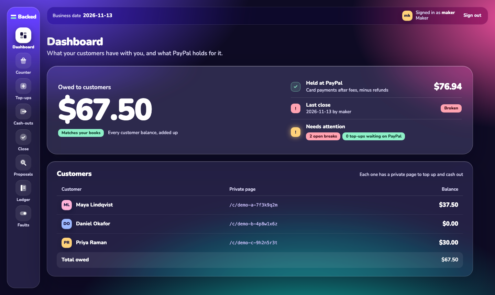
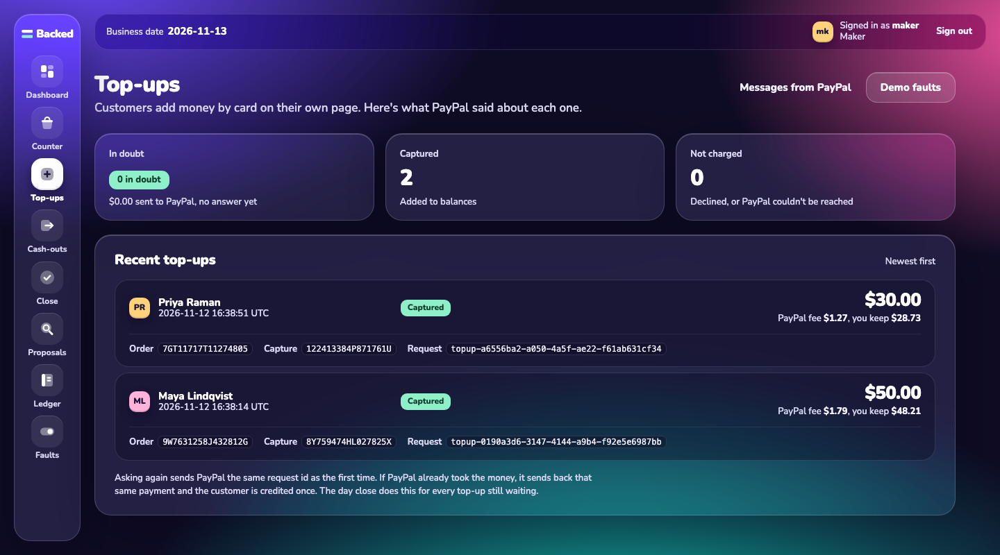
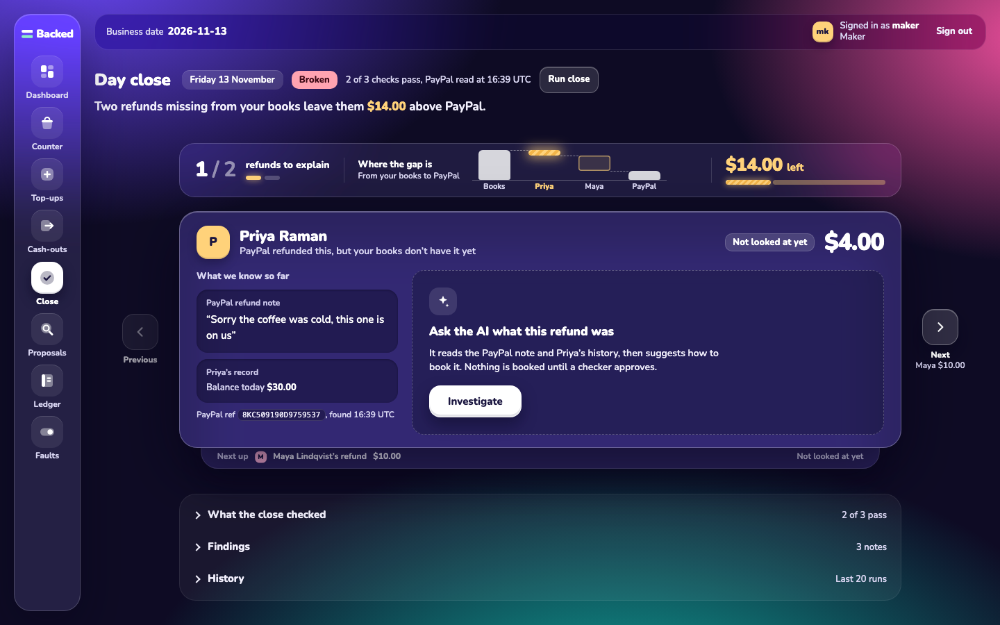
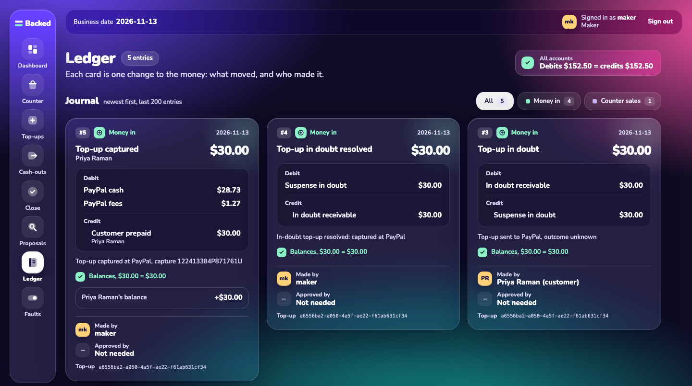
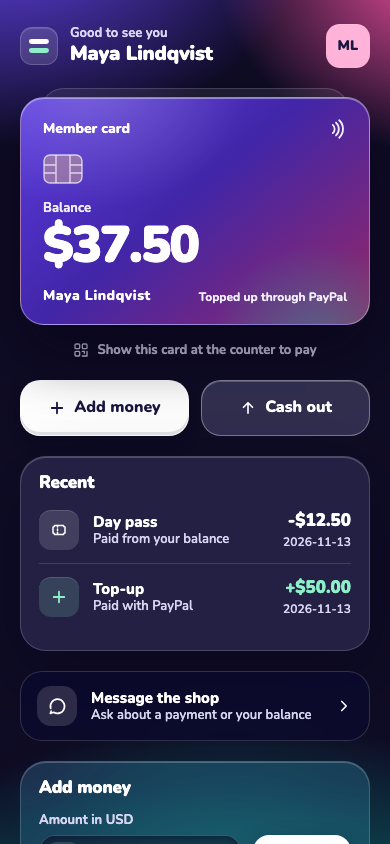

# Backed

Backed is a prepaid-balance ledger for small shops that take customer money up front: a climbing
gym's class packs, a cafe's house tabs, any stored value a customer tops up and spends later.
PayPal is the only rail the money moves on, and every day Backed closes its books against PayPal's
own records. When PayPal shows something the ledger cannot explain, an AI investigator reads the
evidence and proposes a correction, code checks it, and a second person approves it.

## What it looks like

These are from a development run against the PayPal sandbox, after the demo top-ups, a counter sale
and two refunds made outside the ledger, before anyone has asked the AI about them.



The dashboard: what customers are owed, what PayPal holds, the last close and what needs attention.



Top-ups: each card payment with PayPal's answer, its fee, and the order, capture and request ids.



The day close: the band shows progress, where the gap is and what is left, and the card on stage waits for Investigate.



The ledger: one card per journal entry, its debits and credits, and who made and approved it.



A customer's own page on a phone: balance, recent activity, add money and cash out.

## The problem

A shop that holds prepaid balances owes that money to its customers, and the owner usually keeps
track of it in a spreadsheet or a point-of-sale add-on that trusts every "payment succeeded"
message. Three things go wrong in practice:

- A payment request times out after PayPal has already charged the card. The customer sees an
  error, pays again, and is charged twice, or the shop never credits the first payment.
- Refunds are made by hand in the PayPal dashboard ("sorry about the cold coffee", "here is part of
  your balance back") and never reach the books, so the balance the shop thinks it owes drifts away
  from the money PayPal actually holds.
- When the numbers stop matching, someone has to work out what each unexplained movement was and
  write the correcting entry, which is slow and easy to get wrong.

Backed treats these as the normal case. A timeout is recorded as "outcome unknown" and settled by
asking PayPal, never by guessing. The day only counts as closed when the ledger and PayPal agree to
the cent. Anything else becomes a break that is investigated, corrected and approved.

## What happens in the demo

The demo uses three fictional members of a small climbing gym. Each has a private page
(`/c/{token}`) where they top up, cash out and message the shop. Staff sign in as `clerk`,
`maker` or `checker`. The staff menu has Dashboard, Counter, Top-ups, Cash-outs, Close, Proposals,
Ledger and Faults, and shows each role only the pages it can open.

1. **Top-up.** Maya adds $50.00 on her page (**Add money**, then **Top up**). Backed creates a
   PayPal order paid with a sandbox card, PayPal captures it, and the ledger credits her $50.00 and
   books PayPal's fee.
2. **Lost response.** On the Demo faults page (Faults in the menu) the maker arms "Drop the response
   of the next capture after PayPal has accepted it". Maya adds $30.00; PayPal charges the card but
   Backed never hears back. Her page says *Processing: PayPal has not confirmed your $30.00 payment
   yet ... Please do not pay again.* and lists the payment as *Waiting for PayPal*, and a second
   top-up attempt is refused while the first is in doubt.
3. **Resolve.** On the Top-ups page the payment is shown as *Not sure yet*, and the maker presses
   **Ask PayPal now**. Backed re-sends the same `PayPal-Request-Id`, PayPal returns the capture it
   already made, and Maya is credited once.
4. **Spend.** On the Counter page the clerk charges a $12.50 day pass to Maya's balance. The debit
   is conditional in the database, so a balance can never go below zero, even under concurrent
   sales.
5. **A refund outside the ledger.** On the Demo faults page the maker refunds $20.00 of Maya's
   first top-up directly at PayPal (**Refund at PayPal, not in the ledger**) with the note
   "Returning $20.00 of your class pack balance, as you asked". This stands in for a refund made by
   hand in the PayPal dashboard. Nothing is written to the ledger.
6. **Close.** On the Day close page (Close in the menu) the maker presses **Run close**. Backed
   reads every order from PayPal and finds a refund it has no record of. The day is **Broken**, with
   $20.00 unexplained. The page shows one break at a time: a band with the progress (refunds to
   explain), a small waterfall from the books to PayPal and the amount left, and under it a card for
   Maya's refund with PayPal's refund note.
7. **Investigate.** On that card ("Ask the AI what this refund was") the maker presses
   **Investigate**. The model reads PayPal's refund, Maya's ledger history and her message ("Could
   you send $20 of my class pack back to my card?") and picks *balance returned*, quoting both. Code
   builds the journal entry from PayPal's amounts and runs its checks. The maker is back on the day
   close, and the card now shows what the AI read with the quoted words marked, the AI's call, and
   what approving changes in the books: the entry lines, and PayPal cash, Maya's balance and the
   unexplained amount now and after posting, with a switch to the treatment the AI turned down and
   one line on the effect on Maya's balance and the shop's profit. The full reasoning and evidence
   are on the proposal page.
8. **Approve.** The bottom of the card is the relay from maker to checker to posted. The maker
   cannot approve their own proposal; the card says a different person with the checker role
   approves it. The checker opens the same day close, where the card says *Ready to approve*, and
   presses **Approve and post** (or **Dismiss**); either way the checker comes back to the day
   close. Approving posts the correcting entry dated the next business date and runs the close
   again: **Closed**, "Closed, to the cent", nothing unexplained.
9. **Cash-out.** Maya presses **Cash out everything** on her page. Backed splits the refund across
   her captures, newest first, never more than is still refundable on each, and a relay sends each
   refund to PayPal outside any database transaction. The relay runs by itself every few seconds;
   **Send refunds now** on the Cash-outs page runs it at once.
10. **Close again.** The final close is **Closed**, and **Advance to next business day** moves the
    business date on.

The same sequence through the same web routes, with PayPal and the model replaced by in-memory
stand-ins, is the test `DemoStoryTest`.

## How PayPal is used

All calls go through the PayPal Java Server SDK (`com.paypal.sdk:paypal-server-sdk:2.4.0`) against
the sandbox, in `SdkPayPalGateway`.

| PayPal API | Where | Why |
|---|---|---|
| Orders v2: create order (`intent: CAPTURE`, `payment_source.card`) | top-up | Charges the customer's sandbox card in one call. `custom_id` carries the top-up id. |
| Orders v2: capture order | top-up | Only if PayPal leaves the order `APPROVED` instead of completing it on create. |
| Payments v2: refund captured payment | cash-out relay, Demo faults page | Pays a balance back to the card it came from, with a note to the payer. |
| Orders v2: show order details | day close, in-doubt resolution | The close compares every order's captures and refunds, including refunds made outside Backed, with the ledger. |
| Payments v2: show captured payment details | day close, investigator | Gross, fee and net of a capture, and its order. |
| Webhooks: `PAYMENT.CAPTURE.COMPLETED`, `PAYMENT.CAPTURE.REFUNDED` | `POST /webhooks/paypal` | Each event is stored once by its id; the next close checks any capture or refund it names. |

How the calls are made:

- **Idempotency.** Every top-up and cash-out write carries a `PayPal-Request-Id` that is stored in
  the database before the call (`topup-<id>`, `cashout-<id>-leg-<n>`). A retry re-sends the same id, so PayPal returns
  the original result instead of charging or refunding twice.
- **No hidden retries.** The SDK's own retry interceptor is turned off and timeouts are explicit.
  Backed decides when to retry, based on the classification below.
- **Fees.** Gross, fee and net come from PayPal's `seller_receivable_breakdown` and
  `seller_payable_breakdown`. The ledger books what PayPal reports.
- **No Transaction Search.** The close reads orders, captures and refunds directly.
- **Webhook signatures.** Verification through `/v1/notifications/verify-webhook-signature` is
  built but off by default (`backed.webhooks.verify-signature=false`).

`SandboxCheck` (see "Run it") runs the assumptions above against the live sandbox: a card capture
completes without payer action, re-sending a request id returns the same order and capture, two
partial refunds succeed, refunds and their notes appear in the order, and an over-refund is
rejected with a 4xx. During development it passed all five checks.

## How AI is used

The investigator is one model call per break, with no tools. It runs on OpenAI or on Claude:

- **OpenAI** (`OpenAiInvestigator`): the Responses API called over HTTPS with the JDK HTTP client,
  Structured Outputs with a JSON schema in strict mode, `store: false`. Default model `gpt-5.4-mini`.
- **Claude** (`ClaudeInvestigator`): the Messages API through the Anthropic Java SDK, structured JSON
  output. Default model `claude-opus-5-5`.

Both send the same prompt and hold the model to the same JSON schema. `BACKED_AI_PROVIDER` (`openai`
or `anthropic`) picks one; when it is not set, OpenAI is used if `OPENAI_API_KEY` is set, otherwise
Claude if `ANTHROPIC_API_KEY` is set. `BACKED_AI_MODEL` overrides the model. The demo runs on OpenAI.
Every proposal records the provider and model that answered, and the proposal
pages show it.

Its input is one evidence document: PayPal's refund or capture as returned by PayPal, including the
note to payer, the customer's recent ledger history, their messages to the shop, their top-ups, their
balance and any other open breaks.

| Who | Decides |
|---|---|
| The model | Which treatment fits: *balance returned*, *goodwill*, *duplicate reversal*, or *needs a human*. It must quote the evidence it relied on, name the alternative it rejected and why, and write a short note for the customer. It never supplies an amount or an id. |
| Code (`DraftBuilder`, `DraftValidator`) | The journal lines, from the treatment and PayPal's amounts. Then a checklist: the break is still open, the entry balances, the amounts equal PayPal's (recomputed independently), only the accounts allowed for that treatment are used, every quote is a verbatim substring of the evidence, the customer's balance would not go below zero, and any dollar amount in the customer note appears in the evidence. A draft that fails is stored as rejected with the reasons. |
| A person | The `maker` requests the investigation. A different user, the `checker`, approves it. The server rejects self-approval, re-validates against fresh data at approval time, and posts the entry once even if two approvals race. The close then runs again. |

Without either key everything else works; every staff page shows a banner saying the investigator is
not configured and which variable to set, and the Investigate buttons are hidden. Missing PayPal
credentials get the same kind of banner. A failed call (timeout, rate limit, refusal, an answer that
does not fit the schema) is shown on the page as a short message, and nothing is proposed.

## Run it

You need Java 21. Nothing else: an embedded PostgreSQL starts with the app.

```sh
export PAYPAL_CLIENT_ID=...        # PayPal sandbox REST app
export PAYPAL_CLIENT_SECRET=...
export OPENAI_API_KEY=...          # optional; only the investigator needs a key
# or: export ANTHROPIC_API_KEY=... (with both set, OpenAI is used unless BACKED_AI_PROVIDER=anthropic)
./gradlew bootRun
```

Instead of exporting them, you can copy `.env.example` to `.env` at the repository root; it is
read at startup and git-ignored.

Open <http://localhost:8080>. Demo logins, password `demo` for all:

| user | role | can |
|---|---|---|
| `clerk` | counter | charge balances at the counter |
| `maker` | operations | resolve top-ups, run the cash-out relay, run the close and advance the date, request investigations, demo faults, the counter |
| `checker` | approver | approve or dismiss proposals; read every staff page |

The server enforces these per route, and pages hide the buttons a role cannot use.

Customer pages (no login): `/c/demo-a-7f3k9q2m`, `/c/demo-b-4p8w1x6z`, `/c/demo-c-9h2n5r3t`. The
dashboard links to them.

Top-ups use a sandbox test card. The default is the generic Visa test number; to use a card from
the PayPal sandbox card generator, set `BACKED_TEST_CARD_NUMBER`, `BACKED_TEST_CARD_EXPIRY`
(YYYY-MM) and `BACKED_TEST_CARD_CVV`.

Check the PayPal assumptions against the sandbox (charges the test card $10.00 and refunds $5.00
of it, then exits with the number of failed checks):

```sh
./gradlew bootRun --args='--spring.profiles.active=sandbox-check'
```

Run the tests. PayPal and the model are in-memory stand-ins and PostgreSQL is real; the OpenAI and
PayPal adapters are tested against local stub servers. Nothing calls the network unless
`OPENAI_API_KEY` or `ANTHROPIC_API_KEY` is exported in the shell (a key that is only in `.env` does
not count): that runs `LiveInvestigatorTest`, three paid calls to the provider chosen as above.

```sh
./gradlew test
```

The suite has 179 tests. Without an exported key, one of them, `LiveInvestigatorTest`, is skipped
by design.

The data lives in the embedded database and starts fresh on every run. To use your own PostgreSQL,
set `BACKED_DB_URL`, `BACKED_DB_USER` and `BACKED_DB_PASSWORD`.

## Guarantees and the tests that prove them

All tests run against a real PostgreSQL.

| Guarantee | Tests |
|---|---|
| A balance never goes below zero: 20 threads spending $1 from $10 give exactly 10 sales, and the ledger still balances | `BalanceServiceTest`, `SpendServiceTest` |
| Every journal entry balances, at most one entry per business event, and the journal is append-only in the database | `JournalServiceTest` |
| A capture whose response was lost is captured once, re-sent with the same request id, and credited once | `TopupServiceTest`, `TopupWebTest`, `FakePayPalGatewayTest` |
| A 5xx on a top-up is in doubt, not "nothing charged", so the customer cannot be charged twice; a failed capture call keeps its order id | `TopupServiceTest`, `SdkPayPalGatewayTest` |
| An in-doubt top-up older than 5 hours is never re-sent (PayPal forgets request ids after about 6), and a scheduler settles them well before | `TopupServiceTest` |
| A new top-up is refused while one for the same customer is in doubt | `TopupServiceTest`, `TopupWebTest` |
| A cash-out across three captures where leg 2 gets a 5xx: on resume only leg 2 is sent again, with its original request id | `CashoutTest` |
| A 4xx on a refund is never retried; the leg fails and the balance is credited back | `CashoutTest` |
| A cash-out leg is never sent twice, even with concurrent relay runs, and an in-doubt leg is never written off for lack of an answer | `CashoutTest` |
| A leg whose refund may exist (a 5xx after the refund, a crash before recording it, a 4xx on an in-doubt re-send) is never credited back to the balance | `CashoutTest` |
| The same webhook delivered twice, or concurrently, is processed once | `WebhookTest` |
| An off-book refund makes the close BROKEN with one break; the approved correction makes it CLOSED | `DayCloseServiceTest`, `DemoStoryTest` |
| A draft with a quote not in the evidence, an amount different from PayPal's, or a balance that would go negative is rejected | `InvestigationTest` |
| Self-approval is rejected, two simultaneous approvals post one entry, and two approvals that book the same refund cannot both post | `ApprovalTest`, `ProposalWebTest`, `RelatedApprovalRaceTest` |
| A typed amount with a decimal comma ("4,50") is refused instead of read as $450.00 | `MoneyTest` |
| The PayPal adapter sends the request id, maps PayPal's errors as in the table below, and makes exactly one request per call | `SdkPayPalGatewayTest` (against a local stub, offline) |
| The OpenAI adapter sends the shared prompt with a strict JSON schema, retries at most once and only on a rate limit or 5xx (never on a quota error), and turns refusals, malformed answers and timeouts into a clear message | `OpenAiInvestigatorTest` (against a local stub, offline) |
| Exactly one investigator is active for every combination of keys and `BACKED_AI_PROVIDER` | `InvestigatorConfigTest` |
| The whole demo story works through the web routes | `DemoStoryTest` |

## Error classification

Every PayPal call ends in one of five outcomes.

| PayPal answer | Meaning | Top-up | Cash-out leg | Day close |
|---|---|---|---|---|
| 2xx | done | `CAPTURED` and booked | `DONE` and booked | uses the data |
| 4xx business error (for example `INSTRUMENT_DECLINED`, `REFUND_AMOUNT_EXCEEDED`) | will never succeed | `DECLINED`, nothing booked (while resolving: `NOT_CAPTURED`) | a `PENDING` leg is `FAILED` at once and credited back; an `IN_DOUBT` leg stays `IN_DOUBT`, because its first request may have refunded | (404 on a read: the object does not exist) |
| connection refused, DNS or TLS failure, no OAuth token | not sent | first attempt: `DECLINED`, nothing charged, customer may try again; while resolving: stays `IN_DOUBT` | stays `PENDING`, retried later with the same request id | the run is recorded as BROKEN with the reason; no breaks are written |
| 5xx, 408, 409, 429 | probably not done, not proven | `IN_DOUBT`, resolved with the same request id; a second top-up is refused meanwhile | stays `PENDING` and is retried with the same request id; after 5 attempts `IN_DOUBT`, never credited back | as above |
| read timeout, or connection dropped during a write | outcome unknown | `IN_DOUBT`, resolved by re-sending the same request id | `IN_DOUBT`, re-sent with the same request id | (on reads, treated as not done) |

PayPal keeps a request id for about 6 hours, so an in-doubt top-up older than 5 hours is not re-sent:
it waits for a person and the close stays BROKEN.

## Limits

- One shop, one currency (USD), three demo staff users held in memory.
- Card handling is demo-only: the server sends a sandbox test card's number to PayPal. A real
  deployment would collect cards with PayPal's hosted card fields or use vaulted payment tokens so
  card data never touches the server.
- This is not a regulated stored-value product, and it makes no claim of legal, regulatory or
  PCI compliance.
- The demo story test uses a scripted stand-in for the model. `LiveInvestigatorTest` calls the real
  model on three situations (cold coffee goodwill, moving away balance returned, charged twice
  duplicate reversal) and only runs when a key is exported. Run against OpenAI `gpt-6.1-sol` on
  2026-11-12, it got the expected treatment in all three, with quotes that passed the validator.
  (The default model was later changed to the cheaper `gpt-5.4-mini`; set `BACKED_AI_MODEL` to use
  another.) The
  demo flow through the pages (sandbox top-up, refund made outside the ledger, close, investigate) was
  also run on OpenAI: once it gave a valid *balance returned* proposal, and once, with the refund note
  "Sorry the coffee was cold, this one is on us", a valid *goodwill* proposal that the checker approved,
  after which the close was CLOSED and the correction was dated the next business date. The Claude path has offline
  tests only here; we had no Anthropic API credit to run it live.
- Webhook signature verification is off by default and has not been run against PayPal.
- Close runs are not serialised against each other, and the close reads PayPal orders one at a
  time, which is fine at demo scale.

## Tools used

- The OpenAI API (Responses API with Structured Outputs, over the JDK HTTP client) for the investigator
  in the demo; the Claude API, through the Anthropic Java SDK, as the other supported provider.
- The PayPal Java Server SDK, generated by APIMatic, for Orders and Payments.
- Spring Boot 4, Thymeleaf, PostgreSQL (embedded through `io.zonky.test:embedded-postgres`), Flyway.
- The code was written with an AI coding agent.

## License

MIT. See [LICENSE](LICENSE).
